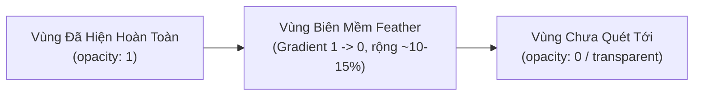

# Hướng Dẫn Kỹ Thuật: Hiệu Ứng Tranh Phác Thảo Quét Mở Bằng GSAP

> **Mục tiêu:** Tái tạo hiệu ứng chuyển động mượt mà (smooth reveal wipe) cho tranh ký họa/phác thảo kiến trúc xuất hiện từ trái sang phải giống video mẫu bằng thư viện **GSAP (GreenSock)**.

---

## 1. Bản Chất Kỹ Thuật Của Hiệu Ứng

Trong video mẫu, hình vẽ tòa nhà thành phố không xuất hiện theo một đường cắt sắc nhọn (*hard clip*), mà xuất hiện với **độ mềm ở rìa viền (feather/soft edge)** như một vệt cọ lướt qua.



Để đạt được hiệu ứng này trên web, có **2 hướng tiếp cận chính**:
* **Phương pháp A (Khuyên dùng - Dành cho ảnh PNG / WebP):** Dùng CSS `mask-image` với `linear-gradient` và animate CSS Custom Variable (`--progress`) bằng GSAP.
* **Phương pháp B (Dành cho file vector SVG nét vẽ thật):** Dùng GSAP animate `strokeDashoffset` (từng nét vẽ xuất hiện nối tiếp nhau).

---

## 2. Phương Pháp A: CSS Gradient Mask Wipe (Ảnh PNG / WebP)

Phương pháp này tối ưu nhất cho các tranh vẽ nhiều chi tiết, màu nước hoặc tranh chì xuất ra dạng ảnh Bitmap (PNG có nền trong suốt).

### 2.1. Cấu Trúc CSS Mask

Ý tưởng cốt lõi: Sử dụng một gradient đen trắng làm mặt nạ (`mask-image`), trong đó:
- Phần màu đen (`#000`): Hiển thị ảnh
- Phần chuyển tiếp: Mờ dần
- Phần trong suốt (`transparent`): Ẩn ảnh

```css
.sketch-img {
  --reveal: 0%;
  --feather: 15%; /* Độ mềm của viền quét */
  
  /* Mặt nạ quét từ trái sang phải */
  -webkit-mask-image: linear-gradient(
    to right,
    #000 0%,
    #000 var(--reveal),
    transparent calc(var(--reveal) + var(--feather)),
    transparent 100%
  );
  mask-image: linear-gradient(
    to right,
    #000 0%,
    #000 var(--reveal),
    transparent calc(var(--reveal) + var(--feather)),
    transparent 100%
  );
  -webkit-mask-size: 100% 100%;
  mask-size: 100% 100%;
  -webkit-mask-repeat: no-repeat;
  mask-repeat: no-repeat;
}
```

> [!NOTE]
> Bắt buộc phải có cả `-webkit-mask-image` và `mask-image` để tương thích hoàn toàn trên Chrome, Safari, iOS Safari, Edge và Firefox.

### 2.2. Kích Hoạt Bằng GSAP

GSAP sẽ animate biến `--reveal` từ `0%` lên `100%`. Để tạo độ chân thực và nghệ thuật, ta kết hợp thêm một chút `scale` và `filter: blur` nhẹ lúc bắt đầu:

```javascript
gsap.to(".sketch-img", {
  "--reveal": "100%",
  duration: 2.2,
  ease: "power2.out", // Bắt đầu dứt khoát, giảm tốc êm ái về cuối
  delay: 0.2
});
```

---

## 3. Mã Nguồn Hoàn Chỉnh (Chạy Trực Tiếp HTML/CSS/JS)

Bạn có thể lưu đoạn code sau thành file `.html` và mở trực tiếp trên trình duyệt để kiểm tra:

```html
<!DOCTYPE html>
<html lang="vi">
<head>
  <meta charset="UTF-8" />
  <meta name="viewport" content="width=device-width, initial-scale=1.0" />
  <title>GSAP Sketch Wipe Reveal Demo</title>
  <!-- Nhúng thư viện GSAP -->
  <script src="https://cdn.jsdelivr.net/npm/gsap@3.12.5/dist/gsap.min.js"></script>
  
  <style>
    * {
      box-sizing: border-box;
      margin: 0;
      padding: 0;
    }

    body {
      font-family: -apple-system, BlinkMacSystemFont, "Segoe UI", Roboto, sans-serif;
      min-height: 100vh;
      display: flex;
      align-items: center;
      justify-content: center;
      background: #1e3a8a; /* Tone nền xanh giống video */
      padding: 24px;
    }

    /* Thẻ Card trắng/kem ở giữa */
    .hero-card {
      position: relative;
      width: 100%;
      max-width: 900px;
      min-height: 520px;
      background: #fbf9f4; /* Màu giấy vẽ kem vintage */
      border-radius: 28px;
      padding: 48px;
      box-shadow: 0 25px 50px -12px rgba(0, 0, 0, 0.35);
      overflow: hidden;
      display: flex;
      flex-direction: column;
      justify-content: space-between;
    }

    .title-group {
      position: relative;
      z-index: 2;
      text-align: center;
      opacity: 0;
      transform: translateY(20px);
    }

    .title-group h1 {
      color: #1e3a8a;
      font-size: 2.2rem;
      font-weight: 700;
      letter-spacing: -0.5px;
    }

    /* Khung chứa tranh phác thảo */
    .sketch-container {
      position: absolute;
      top: 15%;
      left: 0;
      width: 100%;
      height: 60%;
      pointer-events: none;
      z-index: 1;
      display: flex;
      align-items: center;
      justify-content: center;
    }

    .sketch-container img,
    .sketch-container svg {
      width: 90%;
      height: 100%;
      object-fit: contain;

      /* Kỹ thuật CSS Mask */
      --reveal: 0%;
      --feather: 14%;
      -webkit-mask-image: linear-gradient(
        to right,
        #000 0%,
        #000 var(--reveal),
        transparent calc(var(--reveal) + var(--feather)),
        transparent 100%
      );
      mask-image: linear-gradient(
        to right,
        #000 0%,
        #000 var(--reveal),
        transparent calc(var(--reveal) + var(--feather)),
        transparent 100%
      );
      -webkit-mask-repeat: no-repeat;
      mask-repeat: no-repeat;
      will-change: mask-image, -webkit-mask-image;
    }

    /* Hàng 3 thẻ con phía dưới */
    .bottom-cards {
      position: relative;
      z-index: 2;
      display: grid;
      grid-template-columns: repeat(3, 1fr);
      gap: 16px;
      margin-top: auto;
    }

    .sub-card {
      background: rgba(255, 255, 255, 0.7);
      backdrop-filter: blur(8px);
      border: 1px solid rgba(30, 58, 138, 0.12);
      border-radius: 16px;
      padding: 20px;
      font-size: 0.85rem;
      color: #1e3a8a;
      opacity: 0;
      transform: translateY(30px);
    }

    .replay-btn {
      position: absolute;
      top: 16px;
      right: 16px;
      background: rgba(30, 58, 138, 0.1);
      border: none;
      padding: 6px 14px;
      border-radius: 20px;
      color: #1e3a8a;
      font-weight: 600;
      cursor: pointer;
      font-size: 0.8rem;
      z-index: 10;
      transition: background 0.2s;
    }
    .replay-btn:hover {
      background: rgba(30, 58, 138, 0.2);
    }
  </style>
</head>
<body>

  <div class="hero-card">
    <button class="replay-btn" id="replayBtn">Chạy Lại</button>

    <!-- 1. Tiêu đề chính -->
    <div class="title-group" id="title">
      <h1>Building a Brighter Future<br/>with Africa's Energy</h1>
    </div>

    <!-- 2. Tranh phác thảo quét mở -->
    <div class="sketch-container">
      <!-- Thay 'sketch-city.png' bằng đường dẫn ảnh sketch thực tế của bạn -->
      
    </div>

    <!-- 3. Các thẻ nội dung con -->
    <div class="bottom-cards">
      <div class="sub-card info-card">
        <strong>THỰC TRẠNG:</strong>
        <p>Chiếm gần 8% trữ lượng khí đốt toàn cầu nhưng thiếu hụt hạ tầng khai thác.</p>
      </div>
      <div class="sub-card info-card">
        <strong>CƠ HỘI:</strong>
        <p>Thúc đẩy công nghiệp hóa và tạo nguồn việc làm bền vững.</p>
      </div>
      <div class="sub-card info-card">
        <strong>HÀNH ĐỘNG:</strong>
        <p>Cầu nối chuyển đổi dữ liệu thành các chính sách thực thi.</p>
      </div>
    </div>
  </div>

  <script>
    function runAnimation() {
      // Tạo timeline GSAP để điều phối các chuyển động chuẩn xác
      const tl = gsap.timeline({ defaults: { ease: "power2.out" } });

      // Bước 1: Reset trạng thái
      gsap.set("#title", { opacity: 0, y: 25 });
      gsap.set("#sketchImg", { "--reveal": "0%" });
      gsap.set(".info-card", { opacity: 0, y: 35 });

      // Bước 2: Chuỗi chuyển động nhịp nhàng (Choreography)
      tl
        // 2.1 Tiêu đề hiện lên trước
        .to("#title", {
          opacity: 1,
          y: 0,
          duration: 0.8,
          ease: "power3.out"
        })
        // 2.2 Tranh phác thảo bắt đầu quét mở (bắt đầu hơi sớm hơn một chút với '-=0.4s')
        .to("#sketchImg", {
          "--reveal": "100%",
          duration: 2.2,
          ease: "power2.inOut"
        }, "-=0.4")
        // 2.3 3 thẻ con xuất hiện so le khi tranh đã vẽ được quá nửa
        .to(".info-card", {
          opacity: 1,
          y: 0,
          duration: 0.8,
          stagger: 0.15, // Mỗi thẻ cách nhau 0.15 giây
          ease: "back.out(1.2)"
        }, "-=1.2");
    }

    // Chạy khi trang tải xong
    window.addEventListener("DOMContentLoaded", runAnimation);

    // Nút chạy lại để kiểm tra
    document.getElementById("replayBtn").addEventListener("click", runAnimation);
  </script>
</body>
</html>
```

---

## 4. Tích Hợp Vào Dự Án React / Next.js

Nếu bạn đang làm việc với React hoặc Next.js (App Router / Pages Router), sử dụng hook chính thức `@gsap/react` (`useGSAP`) để dọn dẹp bộ nhớ (cleanup) tự động, tránh hiện tượng giật lag khi re-render:

```bash
npm install gsap @gsap/react
```

### Component React Mẫu:

```tsx
"use client";

import React, { useRef } from "react";
import gsap from "gsap";
import { useGSAP } from "@gsap/react";

export default function SketchRevealSection() {
  const containerRef = useRef<HTMLDivElement>(null);
  const sketchRef = useRef<HTMLImageElement>(null);

  useGSAP(
    () => {
      const tl = gsap.timeline({ defaults: { ease: "power2.out" } });

      tl.from(".title-text", {
        opacity: 0,
        y: 20,
        duration: 0.9,
        ease: "power3.out",
      })
      .to(sketchRef.current, {
        "--reveal": "100%",
        duration: 2.0,
        ease: "power2.inOut",
      }, "-=0.3")
      .from(".card-item", {
        opacity: 0,
        y: 30,
        stagger: 0.15,
        duration: 0.7,
        ease: "power3.out",
      }, "-=1.0");
    },
    { scope: containerRef }
  );

  return (
    <div ref={containerRef} className="relative w-full max-w-4xl p-8 bg-[#fbf9f4] rounded-3xl overflow-hidden shadow-2xl">
      <h1 className="title-text text-3xl font-bold text-center text-blue-900 mb-6">
        Building a Brighter Future with Africa's Energy
      </h1>

      <div className="relative w-full h-72 flex items-center justify-center my-4">
        
      </div>

      <div className="grid grid-cols-1 md:grid-cols-3 gap-4 mt-6">
        <div className="card-item bg-white/80 p-4 rounded-xl border border-blue-100">
          <p className="font-semibold text-blue-900">Current Reality</p>
        </div>
        <div className="card-item bg-white/80 p-4 rounded-xl border border-blue-100">
          <p className="font-semibold text-blue-900">With Gas, Africa Can</p>
        </div>
        <div className="card-item bg-white/80 p-4 rounded-xl border border-blue-100">
          <p className="font-semibold text-blue-900">Data & Action</p>
        </div>
      </div>
    </div>
  );
}
```

---

## 5. Phương Pháp B: Dành Cho SVG Nét Vẽ (Draw Effect)

Nếu bạn có file đồ họa định dạng **SVG** với các thẻ `<path>`, bạn có thể tạo hiệu ứng nét bút vẽ từng đường như tranh vẽ thực sự bằng thuộc tính `stroke-dasharray` và `stroke-dashoffset`:

```javascript
// Chuẩn bị: Thiết lập độ dài nét vẽ bằng với chu vi đường path
const paths = document.querySelectorAll("svg path");

paths.forEach((path) => {
  const length = path.getTotalLength();
  gsap.set(path, {
    strokeDasharray: length,
    strokeDashoffset: length
  });
});

// Animate các nét xuất hiện từ từ
gsap.to(paths, {
  strokeDashoffset: 0,
  duration: 2.5,
  stagger: 0.05,
  ease: "power2.inOut"
});
```

---

## 6. Bí Quyết Để Đạt Độ Mượt Tối Đa (Smooth Best Practices)

> [!TIP]
> 1. **Dùng GPU Acceleration:** Thêm `will-change: mask-image, -webkit-mask-image;` vào CSS của element tranh vẽ để trình duyệt đưa tác vụ compositing lên card đồ họa GPU.
> 2. **Điều chỉnh độ mềm Feather:** Biên độ `calc(var(--reveal) + 12%)` đến `calc(var(--reveal) + 18%)` tạo cảm giác chuyển tiếp tự nhiên nhất. Nếu để quá nhỏ (dưới 5%), đường cắt sẽ bị cứng; nếu để quá lớn (trên 30%), tranh sẽ bị mờ đục quá lâu.
> 3. **Easing khuyên dùng:** Tránh dùng `linear` vì nhìn sẽ máy móc. Hãy dùng `power2.inOut` hoặc `cubic-bezier(0.25, 1, 0.5, 1)` để tạo nhịp điệu: vút nhẹ lúc xuất phát và êm dần khi về đích.
